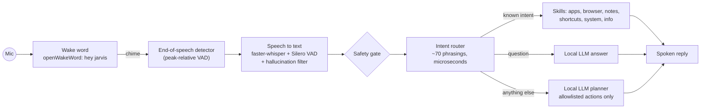

# Surf: a local voice assistant for Windows

Say **"Hey Jarvis"**, then a command. Surf opens apps, searches the web, plays music, types or writes for you, answers questions, and drives everyday keyboard shortcuts. Everything runs **on your PC**: wake word, speech recognition and the language model are all local, so nothing you say leaves the machine.

```
"Hey Jarvis, open Chrome and search YouTube for lofi beats"
"Hey Jarvis, what time is it?"
"Hey Jarvis, open Notepad and write a short email saying I'll be late"
"Hey Jarvis, who wrote the Ramayana?"
"Hey Jarvis, save this file"          "...go back"          "...volume down"
```

## How it works



1. **Wake word.** openWakeWord listens for "hey jarvis" on a single 80 ms audio stream (about 1–2% CPU). A rising chime means Surf is listening.
2. **End of speech.** Surf stops recording about 0.9 s after you stop talking. It compares loudness with *your own speech peak*, not just room noise, so a fan or AC doesn't keep it recording.
3. **Transcription.** faster-whisper (`base.en`, int8 on CPU) with built-in voice-activity filtering. Low-confidence segments and Whisper's well-known subtitle hallucinations ("Thank you very much.", "Thanks for watching!") are discarded instead of being executed.
4. **Routing.** A deterministic router handles common commands instantly, including compound ones ("open notepad and type …"). It only splits on "and" when a new action follows, so "play rock and roll on YouTube" stays one search.
5. **Local LLM (Ollama)** is used only when needed: to answer questions, write text, or plan an unfamiliar request. Plans are validated against an allowlist of safe actions. The model can't run shell commands.

## What it can do

| Area | Examples |
|---|---|
| Apps | open Chrome / Notepad / Calculator / VS Code / Spotify / any Start-menu app · close Chrome |
| Web | search Google for …, search YouTube for …, play … on YouTube, open github.com |
| Music | play … on Spotify |
| Writing | type …, write a poem about … / write an email to … (composed by the local LLM, typed into a fresh Notepad tab) |
| Questions | what time is it, what's the date, who / what / how / why … (spoken answer) |
| Shortcuts | save, undo, redo, copy, paste, select all, go back / forward, refresh, next tab, new tab, close tab, switch windows, minimise, maximise, show desktop, zoom in / out, scroll up / down |
| System | volume up / down, mute, take a screenshot, click "Save" (on-screen text via OCR) |
| Anything else | planned by the local LLM from safe building blocks (open app, type, hotkey, wait, search…) |

Destructive requests (delete, format a drive, shut down, uninstall…) are refused before anything runs.

## Setup (Windows 10/11)

1. **Python 3.11+**, then:
   ```powershell
   python -m venv .venv
   .venv\Scripts\activate
   pip install -r requirements.txt
   ```
2. **Ollama** from https://ollama.com, then `ollama pull llama3.2` (Surf works without it; questions, writing and LLM planning just become unavailable).
3. Optional: **Tesseract OCR** for "click <text>".

On first run Surf downloads the wake-word model (~4 MB) and the Whisper model (~140 MB).

## Run

```powershell
python main.py --voice     # hands-free: "Hey Jarvis, ..."
python main.py --text      # type commands (no microphone needed)
python main.py --voice --hud   # with the animated HUD overlay
pythonw main.pyw           # background: tray icon, no console, always listening
```

To start with Windows, put a shortcut to `pythonw.exe main.pyw` in `shell:startup`.

## Configuration

All settings live in `core/config.py` and can be overridden with environment variables:

| Variable | Default | Purpose |
|---|---|---|
| `SURF_WAKE_WORD` | `hey_jarvis` | Any openWakeWord model name |
| `SURF_WAKE_THRESHOLD` | `0.5` | Raise if it wakes by accident, lower if it misses you |
| `SURF_VOICE_MODEL` | `base.en` | `tiny.en` = faster, `small.en` = more accurate |
| `SURF_SILENCE_LIMIT` | `0.9` | Seconds of quiet that end a command |
| `SURF_LLM_MODEL` | `llama3.2` | Any Ollama model |
| `SURF_LLM_TIMEOUT` | `45` | Seconds to wait for the LLM |

Moving the mouse into a screen corner aborts any automation instantly (pyautogui failsafe).

## Tests

```powershell
pip install -r requirements-dev.txt
pytest -m "not slow"   # 90+ fast tests: routing, safety, pipeline, end-of-speech, filters
pytest -m slow         # end-to-end: synthesised speech -> real wake word + Whisper models
```

The slow tests generate speech with the Windows voice, so the whole audio pipeline is tested without anyone talking into a microphone: "Hey Jarvis" must trigger the wake word, other speech and noise must not, and a spoken compound command must transcribe and route correctly.

## Project layout

```
main.py / main.pyw     entry points (interactive / background)
agent/                 pipeline, router, autocorrect, safety, speaker, app index
voice/                 wake-word loop (assistant.py) and speech-to-text (recognizer.py)
wake/                  openWakeWord detector
core/                  config, audio capture + end-of-speech, desktop helpers, logging
skills/                apps, browser, notes/writing, shortcuts, system, info
llm/                   Ollama planner, answers, writing
executor/              runs validated LLM plans
interface/ tray/       HUD overlay and tray icon
```

## Known limitations

- Windows only (SAPI voice, Win32 window and clipboard APIs).
- A small local model answers general-knowledge questions reasonably, but it has no live data (news, weather, prices) and planning unusual tasks can take 10–30 s on a CPU.
- "Hey Jarvis" is openWakeWord's pre-trained model; a custom "Hey Surf" would need training your own model.
